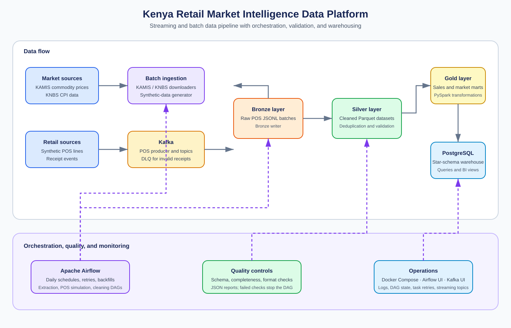

# Kenya Retail Market Intelligence Data Platform

An end-to-end local data platform for analysing Kenyan retail activity, commodity prices, and inflation. The project combines KAMIS market-price data, KNBS CPI data, synthetic point-of-sale (POS) transactions, Kafka streaming, PySpark transformations, PostgreSQL warehousing, and Apache Airflow orchestration.

## Contents

- [Architecture](#architecture)
- [Capabilities](#capabilities)
- [Prerequisites](#prerequisites)
- [Quick start](#quick-start)
- [Project structure](#project-structure)
- [End-to-end workflow](#end-to-end-workflow)
- [Data layers and quality](#data-layers-and-quality)
- [Warehouse and analysis](#warehouse-and-analysis)
- [Airflow operations](#airflow-operations)
- [Docker services](#docker-services)
- [Troubleshooting](#troubleshooting)

## Architecture



The platform separates raw, cleaned, and analytical data into Bronze, Silver, and Gold layers. PostgreSQL exposes a star-schema warehouse for business analysis. Airflow schedules data collection, POS simulation, Silver-layer validation, retries, and bounded backfills; Kafka and Airflow UIs provide operational visibility.

## Capabilities

- Collect KAMIS commodity-market prices and KNBS Consumer Price Index (CPI) data.
- Generate realistic synthetic retail stores, suppliers, products, and POS transaction lines.
- Stream POS receipts through Kafka and write valid raw receipts to Bronze JSONL batches.
- Reject invalid POS events to a Kafka dead-letter queue (DLQ).
- Clean, deduplicate, validate, and CPI-enrich data with PySpark.
- Build Gold sales and commodity-market marts plus a PostgreSQL dimensional warehouse.
- Run five business analyses covering inflation impact, price spreads, store performance, category trends, and supplier concentration.
- Orchestrate collection, simulation, and cleaning workflows with Airflow retries and backfills.

## Prerequisites

- Python 3.10 or 3.11
- [uv](https://docs.astral.sh/uv/)
- Docker Engine with Docker Compose
- Java 17 for PySpark jobs, including those run by Airflow

Install the Python environment from the locked dependency set:

```bash
uv sync --frozen
```

If Java is not at `/usr/lib/jvm/java-17-openjdk-amd64`, set its locations before starting Airflow:

```bash
export JAVA_HOME=/path/to/java-17
export JAVA_CONFIG_DIR=/path/to/java-17-config
```

## Quick start

### 1. Start the local platform

```bash
docker compose --profile airflow --profile ui up -d
```

This starts PostgreSQL, Kafka, Kafka UI, and the Airflow services. Wait for the services to become healthy, then open:

| Service | Address | Credentials |
| --- | --- | --- |
| Airflow UI | http://localhost:8081 | `admin` / `admin` |
| Kafka UI | http://localhost:8080 | — |
| Kafka broker | `localhost:9092` | — |
| PostgreSQL | `localhost:5433` | `retail_user` / `retail_password` |

### 2. Generate source data

Run the batch collection and synthetic-data generator:

```bash
uv run python main.py
```

This downloads or refreshes KAMIS and KNBS inputs and creates the synthetic retail reference data and historical POS lines.

### 3. Produce Bronze POS data

In a separate terminal, run the producer and Bronze writer together:

```bash
uv run python src/pos_simulation/run_all.py --limit 1000 --delay 0.01
```

Valid receipts are written below `data/bronze/pos/`; invalid events are sent to the `pos.transactions.dlq` Kafka topic.

### 4. Build Silver and Gold datasets

```bash
uv run python src/spark/run_pipeline.py
```

### 5. Run quality checks and load the warehouse

```bash
uv run python src/quality/run_quality.py
uv run python src/warehouse/load_warehouse.py
uv run python src/warehouse/run_queries.py
```

## Project structure

```text
.
├── docs/                  # Architecture and supporting documentation assets
├── data/                  # Generated and processed local data (not source code)
├── src/
│   ├── airflow/           # Airflow DAG definitions
│   ├── downloaders/       # KAMIS, KNBS, and synthetic data creation
│   ├── pos_simulation/    # Kafka producer and Bronze consumer/writer
│   ├── quality/           # Dataset validation and JSON reporting
│   ├── spark/             # Bronze-to-Silver and Silver-to-Gold PySpark jobs
│   └── warehouse/         # PostgreSQL DDL, loading, and analytical SQL
├── docker-compose.yml     # Local service topology
├── Dockerfile             # Container image for project workloads
└── main.py                # Batch data collection entry point
```

## End-to-end workflow

1. **Collect and generate data.** `main.py` runs the KAMIS downloader, KNBS downloader, and synthetic-data generator.
2. **Stream POS receipts.** The POS producer emits receipt events to Kafka; the Bronze writer persists valid messages as JSONL and routes invalid messages to the DLQ.
3. **Transform with Spark.** `run_pipeline.py` invokes the Bronze-to-Silver cleaner and Silver-to-Gold mart builder.
4. **Validate data.** The quality module verifies completeness, expected columns, required-field missingness, and field formats, and writes JSON reports.
5. **Load and analyse.** The warehouse loader creates the PostgreSQL schema, loads dimensions and facts, and the query runner executes the business analyses.

## Data layers and quality

| Layer | Location | Purpose |
| --- | --- | --- |
| Bronze | `data/bronze/` | Raw JSONL POS batches preserved from Kafka. |
| Silver | `data/silver/` | Deduplicated, cleaned, type-safe POS, KAMIS, KNBS, and dimension Parquet datasets. |
| Gold | `data/gold/` | Store sales, commodity market comparison, and category trend marts. |
| Quality | `data/quality_reports/` | Timestamped JSON results from validation runs. |

The Silver transformation removes duplicate POS lines using `(transaction_id, line_number)`, filters invalid records, and enriches sales with CPI deflators to calculate real revenue. KAMIS records are also deduplicated on their business key.

Run all validation suites locally:

```bash
uv run python src/quality/run_quality.py
```

The `kenya_retail_data_cleaning` DAG runs Silver validation after cleaning. A failed check raises an error, records the result in a JSON report, and causes the Airflow task to fail after its configured retries.

## Warehouse and analysis

`src/warehouse/schema.sql` defines a PostgreSQL star schema:

| Table or view | Role |
| --- | --- |
| `dim_date`, `dim_store`, `dim_product`, `dim_supplier`, `dim_cpi` | Descriptive dimensions for sales and inflation analysis. |
| `fact_sales` | Transaction-line-item fact table with nominal and real KES amounts. |
| `agg_store_daily_sales` | Pre-aggregated daily store performance. |
| `agg_commodity_market_comparison` | Supermarket POS versus KAMIS commodity price comparison. |
| `agg_monthly_category_trends` | Category sales trends against CPI. |
| `v_*` views | Ready-to-query analytical business views. |

Load or rebuild the local warehouse:

```bash
uv run python src/warehouse/load_warehouse.py
```

Run every analysis, or a single numbered query:

```bash
uv run python src/warehouse/run_queries.py
uv run python src/warehouse/run_queries.py --query 1 --limit 10
```

The available analyses cover county-level inflation erosion, supermarket-to-market price spreads, store and basket rankings, category trends versus inflation, and supplier revenue concentration.

## Airflow operations

Airflow loads project DAGs from `src/airflow/`.

| DAG | Schedule | Workflow |
| --- | --- | --- |
| `kenya_retail_market_intelligence` | Daily | KAMIS extraction → KNBS CPI extraction → synthetic-data generation. |
| `kenya_retail_pos_simulation` | Daily | POS producer emits a configured number of Kafka receipt events. |
| `kenya_retail_data_cleaning` | Daily | Bronze-to-Silver cleaning → Silver data-quality validation. |

Every task inherits two retries with exponential backoff. Failed quality checks and failed subprocesses remain visible in Airflow logs and the Graph/Grid views. DAGs can also be triggered manually from the Airflow UI.

### Backfills

Automatic catchup is disabled to avoid replaying the full history when the services start. Use an explicit, bounded backfill when historical reprocessing is intended:

```bash
docker compose --profile airflow exec -T airflow-scheduler bash -c \
  'source /opt/project/.venv/bin/activate && \
   airflow backfill create --dag-id kenya_retail_market_intelligence \
   --from-date 2026-11-01 --to-date 2026-11-02'
```

Start with a short date range and inspect the resulting DAG runs in Airflow before expanding the range.

## Docker services

| Command | Use case |
| --- | --- |
| `docker compose --profile airflow --profile ui up -d` | Start the full local platform. |
| `docker compose --profile kafka up -d` | Start Kafka and Kafka UI. |
| `docker compose --profile simulation up` | Run the POS producer and Bronze writer together. |
| `docker compose --profile producer up` | Run only the POS producer. |
| `docker compose --profile consumer up` | Run only the Bronze writer. |
| `docker compose --profile airflow --profile ui down` | Stop services while preserving data volumes. |

PostgreSQL uses a health check, and Airflow waits for its initial database migration and administrator creation before starting the API server, scheduler, and DAG processor. Docker volumes preserve the PostgreSQL, Kafka, and Airflow state across normal shutdowns.

## Troubleshooting

| Symptom | Suggested action |
| --- | --- |
| Airflow or Spark cannot find Java | Confirm Java 17 is installed and set `JAVA_HOME` and `JAVA_CONFIG_DIR` before `docker compose up`. |
| A warehouse command cannot connect | Start the stack and confirm PostgreSQL is listening on port `5433`. |
| No Bronze data exists | Run the POS simulation, then check Kafka UI and `data/bronze/pos/`. |
| A quality run fails | Open the newest JSON report in `data/quality_reports/`, correct the source or transformation issue, then rerun the quality command or clear the Airflow task. |
| A DAG does not appear | Check the Airflow DAG processor logs and confirm `src/airflow/` is mounted into the Compose stack. |
| Services need a clean state | Stop the stack first. Only use `docker compose down -v` if you intentionally want to delete local Docker volumes. |

## Stopping the platform

```bash
docker compose --profile airflow --profile ui down
```

This preserves local Docker volumes. Add `-v` only when you intentionally want to delete the PostgreSQL, Kafka, and Airflow state.
